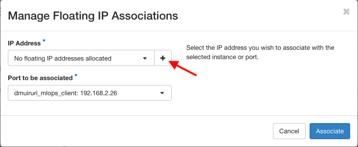
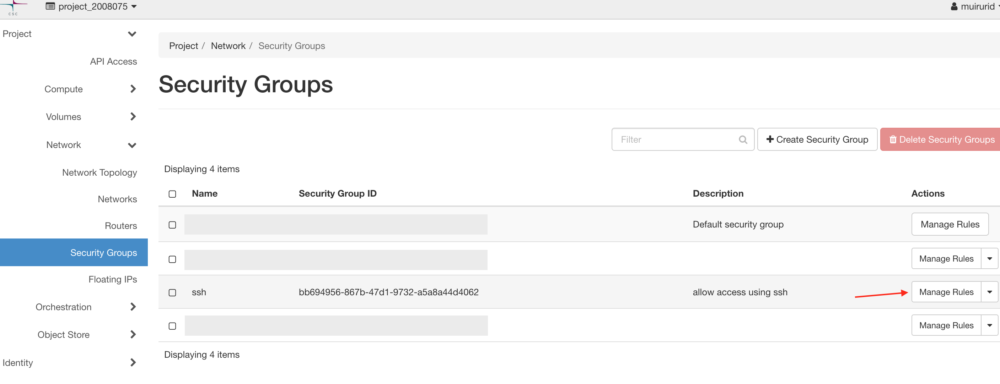
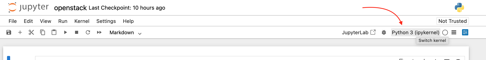
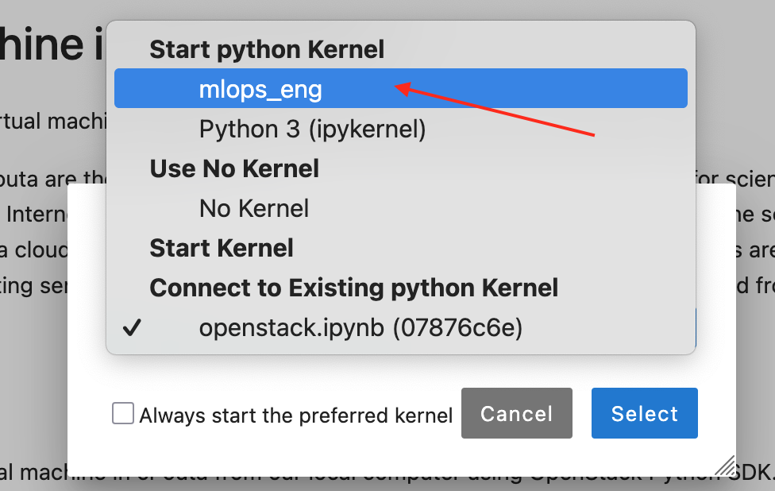

# Setting up the local environment using a VM in cPouta

This instructions are meant as a backup for users who have challenges
with VirtualBox and the provided Ubuntu Image (mlops_eng, Ubuntu
22.04). This is was mainly experience by users with MacOS with Apple
specific Hw (M1/M2 and M3).

For those taking this approach, you will end up with two distinct
instances in cPouta, a "local" client VM and the MLOps VM. This
instructions only replace your local environment.


## Create a client in cPouta

Following [these instructions](https://docs.csc.fi/cloud/pouta/launch-vm-from-web-gui/), create a client VM  in cPouta which will serve as your local machine.
The current cPouta web UI is slightly different from what is indicated in their documents but the general guidelines are similar.


- Details Tab: Create a named instance
- Source Tab: Select Boot Source (Image), Select Ubuntu-22.04 by clicking up arrow
- Flavor Tab: Select standard.xlarge
- Networks Tab: Default settings are ok, project_2008075 is shown
- Network Ports Tab: Do nothing
- Security Groups Tab: Select ssh in addition to the pre-selected default group
- Key Pair Tab: Choose create Key Pair if you do not have an existing key to re-use, and follow the documentation on how to set up the keys
  - Key Pair Name: decide the file name
  - Key Type: Select SSH Key
  - Once you Create Key pair, Copy the private key to your local computer and set it up to work as indicated in the documentation
- Configuration Tab: Do Nothing
- Servier Groups Tab: Do Nothing
- Metadata Tab: Do Nothing, press Launch Instance

Once the VM is successfully created, we need to associate it with a public IP by selecting Associate Floating IP



After a successful ssh setup, we can ssh into the VM from the local
terminal using the assigned floating IP and the ssh key created
earlier.

```bash
ssh ubuntu@80.40.10.11 -i path_to_the_save_ssh_key.pem

ssh ubuntu@<assigned_floating_ip> -i <private_ssh_key_file>
```

Follow the rest of the instructions on setting up your [local environment](./local_env_without_vm.md).
Below are some details on conda installation

### Conda installation
- repo https://repo.anaconda.com/archive/
- pick the correct architecture (Anaconda3-2025.06-1-Linux-x86_64.sh)

```bash
wget https://repo.anaconda.com/archive/Anaconda3-2025.06-1-Linux-x86_64.sh

bash Anaconda3-2025.06-1-Linux-x86_64.sh 
```
Ensure the installed conda is in PATH so that it is possible to invoke it from the command line.

### Setting up Jupyter

Once we have the environment setup, we can now try to create a remote jupyter session

We will need to allow the VM to use the port we use below in csc




```bash
jupyter notebook --no-browser --port=8888 # open a headless jupyter notebook session, run cmd in remote client

ssh -N -L 8888:localhost:8888 ubuntu@<assigned_floating_ip> -i ~/.ssh/ssh_sec_key_to_remote_client # run command on your local terminal 
```

Using your local browser, visting address http://localhost:8888/
should open a jupyter notebook connected to the remote client we have
created.


### Installing virtual environments within Jupyter
We would want to open jupyter with a given virtual environment which contains pre-installed dependencies (mlops_eng)

run commands below in the acticated mlops_eng enviroment in the remote client

```bash
pip install ipykernel # iyt should already be in the environment

ipython kernel install --user --name=mlops_eng # install the environment to jupyter
```

 


