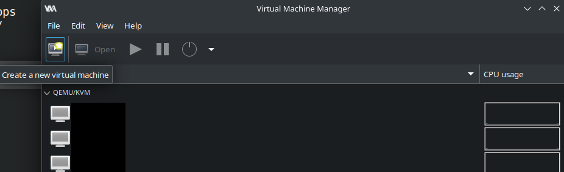
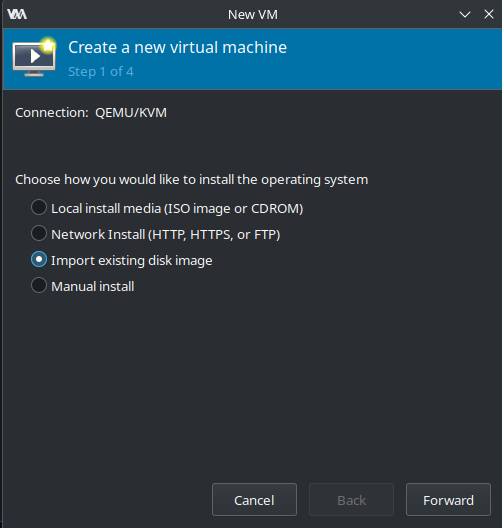
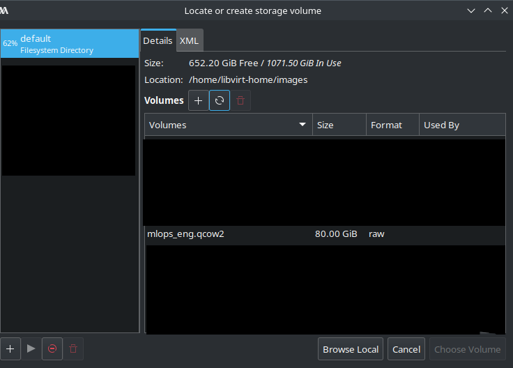
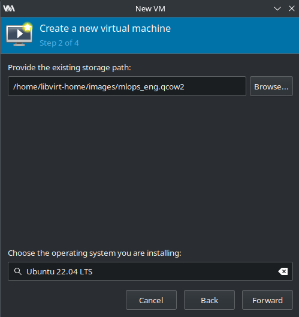
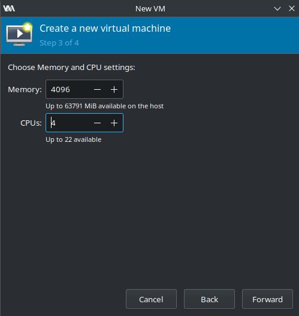
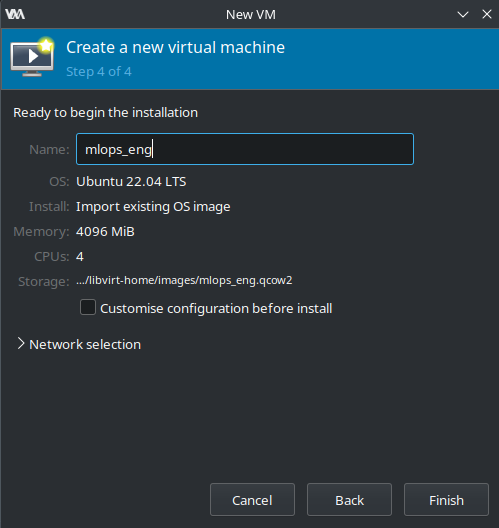
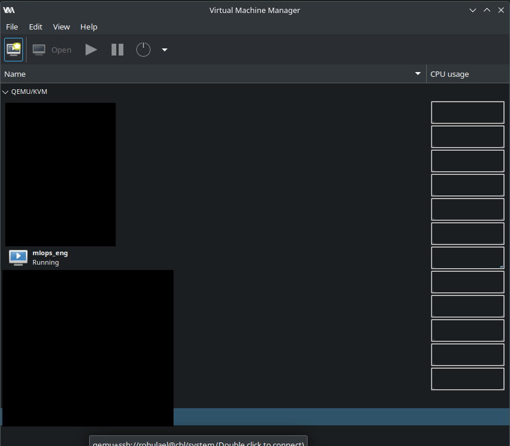
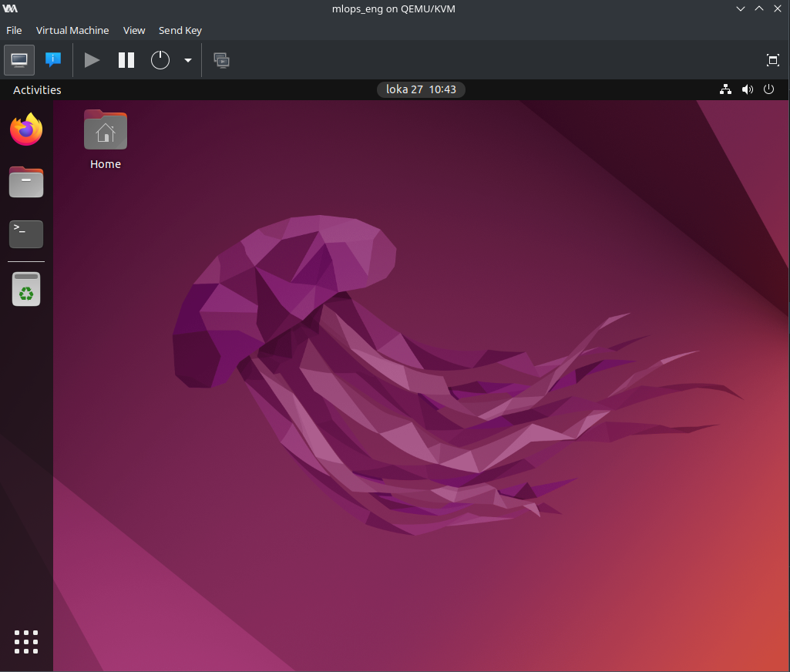

# Using QEMU for setting up a local virtual machine

Installing Virtualbox and its related drivers to a Linux computer is not recommended. It has caused kernel panics in Cubbli computers. However, converting the image to work with `virt-manager` is possible.

These instructions assume you have a Linux laptop with Cubbli, or any other Linux distro installed, which uses `apt` for its package manager.

## Initial setup for Linux computers

**Note**: You need sudo rights for this.

Some reading regarding the responsibilities, and possible dangers of `sudo` can be found from [the Cubbli wiki.](https://wiki.helsinki.fi/xwiki/bin/view/Cubbli/User%20documentation/Administrator%20%28sudo%29%20rights%20in%20Cubbli%20Linux/)

If you have a fuxi laptop, you can activate them with a command: `i-want-sudo-access`.

If you have a faculty laptop, you need to apply for sudo-rights [from Flamma.](https://flamma.helsinki.fi/en/group/it-ja-puhelin/administration-rights-and-administration-responsibility#menu1)

If you have your personal laptop/desktop, you can follow the instructions.

## Installing required packages for Cubbli

Update apt:
```bash
sudo apt update
```

Install `cubbli-kvm` package:
```bash
sudo apt install cubbli-kvm
```

Add your user to `libvirt` group:

```bash
sudo usermod -aG libvirt username
# Replace 'username' with your actual username
```

At this point, log out, and log back in for the changes to take effect.

## Installing required packages for other Linux distros (with apt)

Update apt:
```bash
sudo apt update
```

Install required packages:
```bash
sudo apt install virt-manager ovmf qemu-kvm libvirt-daemon qemu-kvm
```

Add your user to `libvirt` group:

```bash
sudo usermod -aG libvirt username
# Replace 'username' with your actual username
```

At this point, log out, and log back in for the changes to take effect.

## Setting up default pool

On Cubbli computers with **OS version 24 (or higher)**, you can skip this part.

For Cubbli computers with **OS version 22**, or **some other Linux distro** do the following:

Create a pool location under `/home`:
```bash
mkdir -p /home/libvirt-home
```

Set the directory's ownership and permissions:

```bash
sudo chown root:libvirt /home/libvirt-home
sudo chmod 771 /home/libvirt-home
```

Define the default `virsh pool` to the created directory:

```bash
virsh pool-define-as --name default --type dir --target /home/libvirt-home/
virsh pool-autostart default
```

## Converting the VB image for virt-manager

At this point you should have the `mlops_eng.ova` downloaded. Move it to a suitable working location, or leave it as is.

Extract the files from the `mlops_eng.ova` package (will take some time):
```bash
tar xf mlops_eng.ova
```

Convert the image to `.qcow2`:
```bash
qemu-img convert mlops_eng-disk001.vmdk mlops_eng.qcow2
```

Move the converted image to the default pool's directory:
```bash
mv mlops_eng.qcow2 /home/libvirt-home/
```

## Import the virtual machine in virt-manager

**Note:** In some screenshots, the default path might show up as `/home/libvirt-home/images`. This is due to previous configurations on the machine which was used to test the process. You can ignore it, the process should be the same regardless.

Open `virt-manager` from a terminal or an application menu.

Click the top-left icon on the toolbar to create a new virtual machine.



A window will pop up, which will lead you through the process of setting the VM up.

On the first window, select `Import existing disk image`



On the next window, from the default pool, select the converted `mlops_eng.qcow2`.



On the next window, on the bottom, select `Ubuntu 22.04 LTS`.



On the next window you can set the VM's specs. You can leave RAM as is. If you have CPU cores to spare, you could up it to 4 (or more if you want. 2 minimum).



On the next window, give the VM a name (if you want). The creation of the VM is complete after this.



You should now have your `mlops VM` listed in the main `virt-manager` window.



You can double-click it to open the GUI and check it out.



Install qemu-guest-agent on virtual machine for greater control of it:
```bash
sudo apt install qemu-guest-agent
```

If you have troubles using it, please post your issues in the Moodle forum.

If you have troubles setting it up for a **Cubbli computer**, please contact helpdesk@helsinki.fi

---
After you've prepared your local VM, you can go back to the [main instructions](../README.md#5-log-in-to-the-virtual-machine). 
